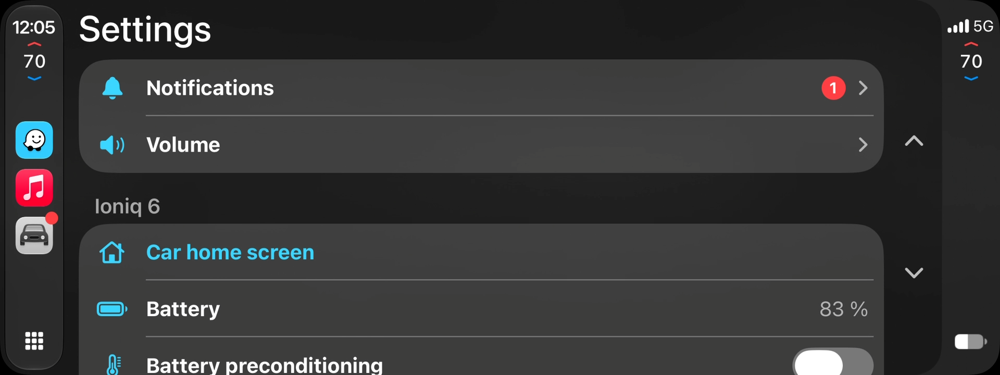
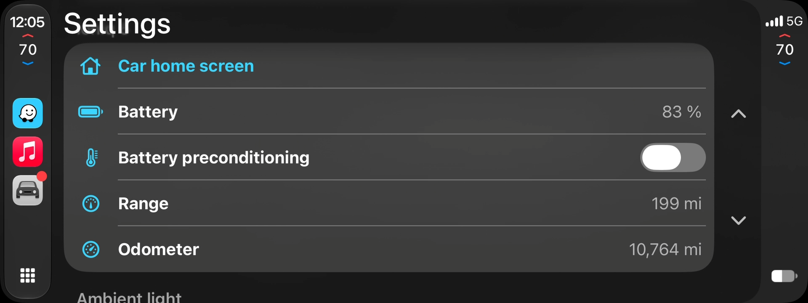
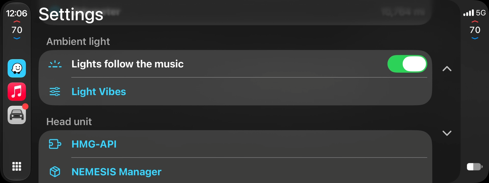
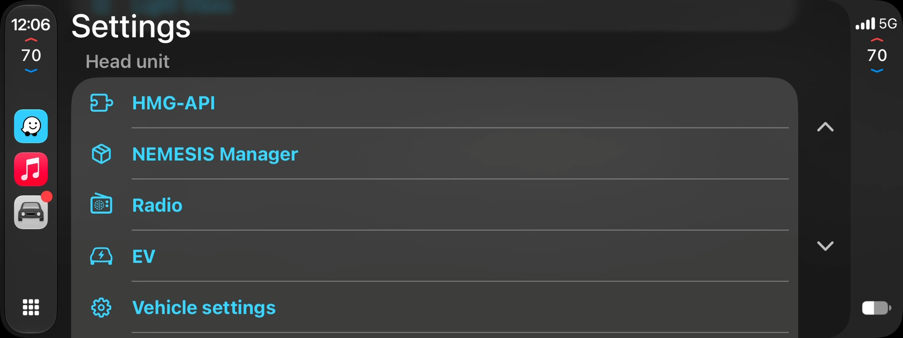
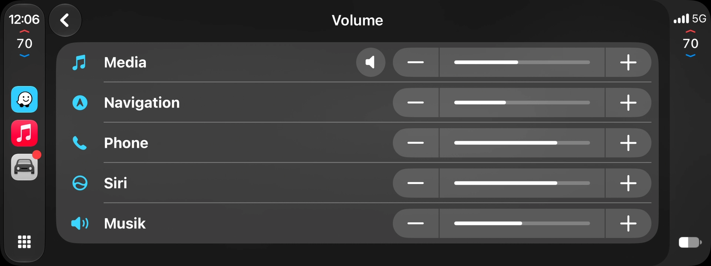
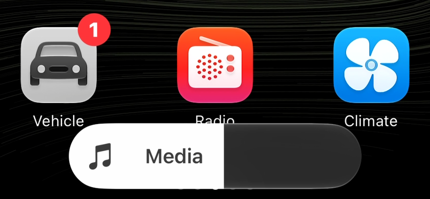

# CarPlay Ultra-Lite

CarPlay Ultra-style features for Hyundai and Kia **Gen5W** head units running **HMG-API**:

- **Climate in CarPlay:**
  - temperatures, fan, A/C, AUTO, SYNC, vents, recirculation, seat heat, and front and rear defrost
  - a climate panel for each seat; the passenger's power button turns off just the passenger side
- **The CarPlay Ultra theme:** wallpapers and colours you pick in CarPlay **Settings > Themes**.
- **Coming in the next release** (running on the test car now, see [In testing](#in-testing-the-next-release)): the car's own page in CarPlay's **Vehicle** app, the car's volume in CarPlay, and vehicle notifications.

**Status:** tested on a **Hyundai Ioniq 6 (US, firmware 260507)**. The Kia EV6 and Hyundai Ioniq 5 should work too; run the compatibility check first. This is an unofficial mod and you use it at your own risk.

## Download

Get **carplay-ultra-lite-bundle-1.0.0.zip** from the [latest release](../../releases/latest) and unzip it; the USB folders the steps below mention are inside. To run only the compatibility check first, get **carplay-ultra-lite-check-1.0.0-usb.zip** and copy its `HMGAPI` folder to the top of a USB stick.

## What you need

- **HMG-API** 1.0.0 or later, working on your car with your car's hook map.
- **Wireless CarPlay:**
  - Ioniq 6: use the wireless CarPlay/Android Auto fix included here (`usb-2-install-ioniq6-with-wireless-fix`).
  - EV6 and Ioniq 5: use HMG-API's official wireless-carplay-aa.
- **An iPhone** on iOS 26 or later (tested on iOS 27.0).
- **A USB stick.**

## Step 1: compatibility check

1. Copy everything inside `usb-1-check` to the top of the USB stick.
2. Plug the stick into the car. In the **HMG-API app**, open **Updates** and install **CarPlay Ultra-Lite compatibility check**. Confirm the author key `4bec7579-…`, then apply, and restart if it asks.
3. About a minute after the screen is up, the report appears on the stick in **`CarPlayUltraLite-Check`**. Open `cp-climate-check.md` on a computer: the table at the top says **YES** or **NO** for each feature.
4. Remove the check in the HMG-API app. It only reads and changes nothing.

If anything says **NO**, don't install. Open an issue with `cp-climate-check.md` and `cp-climate-check.json` attached, or give both to your own Claude together with the `source` folder.

## Step 2: install

1. If the check says an E-GMP CarPlay EV Routing mod on your car is **signed by another author**, remove it in the HMG-API app first ([original project](https://github.com/isaacwisdom/egmp-carplay-ev-routing)). Why: the theme needs the build included here, and the two can't be installed side by side:
   - **HMG-API won't swap them.** Both have the same mod ID, and HMG-API only updates a mod with a package from the same author.
   - **A new name wouldn't help.** Both builds change the same parts of the car's CarPlay connection, so running both could break wireless CarPlay.
   - **You lose nothing.** The build included here does everything the original does, and adds the theme.
   - **Your car stays your car.** The included build carries a separate profile for each car, and HMG-API installs only the one for yours: an EV6 shows in Apple Maps as a Kia EV6 and an Ioniq 5 as an Ioniq 5, each with its own battery size and charging curve. Charge level, range, mileage, speed and gear are always read live from your own car. As in the original, the profiles are for the US long-range battery on firmware 260507.
2. Copy everything inside **`usb-2-install-ioniq6-with-wireless-fix`** (Ioniq 6: it also brings the wireless CarPlay/Android Auto fix the Ioniq 6 needs) or **`usb-2-install-ev6-ioniq5`** (EV6 and Ioniq 5, which already have wireless CarPlay from HMG-API) to the top of the stick.
3. In the HMG-API app, open **Updates** and install every package:
   - Order: wireless-carplay-aa first (Ioniq 6 only), then E-GMP CarPlay EV Routing (it tells the iPhone which theme to load), then CarPlay Ultra-Lite.
   - Confirm the author key `4bec7579-…`.
   - On an EV6 or Ioniq 5, choose **Install anyway**.
4. Apply the changes and restart the head unit.

## Step 3: pair the iPhone again (once)

1. On the iPhone, go to **Settings > General > CarPlay**, tap your car, then **Forget This Car**, and connect again. Keep the iPhone online the first time: it downloads the theme.
2. On the car, open CarPlay **Settings > Themes** and pick a style and wallpaper.

## Settings (HMG-API app)

| Mod | Setting | Default | Notes |
|---|---|---|---|
| CarPlay Ultra-Lite | CarPlay Ultra | on | Off: climate only, with the classic CarPlay look. Also turn EV Routing's CarPlay theme off. |
| CarPlay Ultra-Lite | Rear window defrost | on | Works in READY only. |
| E-GMP CarPlay EV Routing | CarPlay theme | on | Needs CarPlay Ultra on. |

Restart the head unit after changing a setting. After a theme change, also forget and pair the iPhone again.

## In testing: the next release

Version 1.3 is running on the test car (Hyundai Ioniq 6, US, firmware 260507). It is **not in the download yet**; the release above is still 1.0.0. The full list of changes is in the [changelog](CHANGELOG.md).

### The car's page in CarPlay's Vehicle app

- **Live readings:** battery level, range and odometer, read from the car and rounded the way the instrument cluster rounds them. Nothing is sent to the car for these.
- **Car home screen:** a button that takes you to the head unit's own home screen. The car's MEDIA button brings you straight back to CarPlay.
- **Battery preconditioning:** a switch, if [Launchpad](https://github.com/paytondevs/gen5w-preconditioning) is installed. Launchpad stays the one that sends the request, with its own checks and time limit.

- **Ambient light:** a switch for the Light Vibes "lights follow the music" effect and a button that opens Light Vibes, if it is installed.

- **Head unit:** buttons that open the head unit's own screens: HMG-API, NEMESIS Manager, Radio, EV and Vehicle settings.

### The car's volume in CarPlay

- CarPlay's **Volume** page shows the head unit's real levels for media, navigation, phone and Siri, follows the volume knob and the steering wheel buttons, and sets the car's volume when you change it in CarPlay.
- **Experiment, off by default:** while CarPlay is on the screen, the volume knob and the steering wheel's volume and mute buttons show only CarPlay's own slider, not the head unit's volume pop-up. Everywhere else the volume looks and works as always.

### Vehicle notifications

- The Vehicle app has a **Notifications** list, and its icon shows a badge. For now the car posts one entry at each start, to prove the list works; real events come next (see [Planned](#planned)).

### New settings

| Setting | Default | Notes |
|---|---|---|
| The car's page in CarPlay's Vehicle app | on | |
| Car volume in CarPlay | on | CarPlay's Volume page shows and sets the car's levels. |
| Only CarPlay's volume slider in CarPlay (experiment) | off | Handles the volume keys inside the car's system software while CarPlay is on screen. If the volume keys ever misbehave, turn it off and restart. |

### Known issues in the test build

- **Mute:** with the experiment on, the head unit's volume pop-up still flashes for a moment when you press mute on the steering wheel. To be fixed.
- **Radio:** CarPlay's Radio app opens but says "DAB Radio Not Available": the car's tuner isn't connected to it yet. The Radio button in the Vehicle app opens the head unit's own radio.
- **Other cars:** the section is titled "Ioniq 6" on every car, and the preconditioning, Ambient light and screen rows also show on a car that doesn't have those apps, where they do nothing.
- **Volume page:** the last row is still labelled "Musik", a leftover placeholder.

## Good to know

- **Power buttons:** the driver's turns the climate off; the passenger's turns off only the passenger side.
- **Buttons on both sides:** A/C, recirculation and the defrost buttons show on both seats' panels. That's how CarPlay lays them out.
- **Getting back to the car's screens:** while the theme is on, CarPlay has no Hyundai/Kia logo button to tap. Use any of the car's own buttons that lead back to its home screen instead. The next release adds a **Car home screen** button in CarPlay's Vehicle app.
- **USB cable:** plugging a cable into the car's USB port can drop CarPlay for a few seconds; it reconnects by itself.

## Planned

The aim: everything you use the head unit's own screens for, inside CarPlay.

- **Radio:** FM, AM and HD stations and tuning in CarPlay's Radio app, from the head unit's own tuner.
- **Sound settings:** bass, mid, treble, balance, fade and the equaliser presets in CarPlay.
- **Charging:** charging status, time remaining and charge limits in the Vehicle app.
- **Real notifications:** charging finished, a tyre warning, a trip summary when you park.
- **Vehicle settings in CarPlay:** the common ones (drive mode and the like) as rows, not only as a shortcut to the head unit's screen.
- **Light Vibes page:** presets, brightness and mode in CarPlay.
- **Other cars:** rows hidden when a car doesn't have the app behind them, and the section named after the car it runs on.
- **Fixes:** the volume pop-up that still flashes on mute, and the "Musik" label on the Volume page.
- **Being looked into:** Waze alerts (police, hazards) shown on the instrument cluster and through the ambient light.

## Troubleshooting

- **CarPlay stays black:** turn off EV Routing's **CarPlay theme** and restart.
- **The head unit keeps restarting:** HMG-API turns mod hooks off by itself after 3 quick restarts, and CarPlay Ultra-Lite turns itself off after two crashes within 10 minutes. Then disable CarPlay Ultra-Lite in the HMG-API app.
- **Reporting a problem:** attach the check report. Never post iPhone logs publicly: they contain your car's Wi-Fi password.

## Credits and licence

- The climate and vehicle protocol is based on [LIVI](https://github.com/f-io/LIVI) by Lasse Heitgres (GPL-3.0).
- Wireless CarPlay and Android Auto come from [HMG-API](https://github.com/VysseCodes/HMG-API) (AGPL-3.0).
- The theme is switched on through a modified build of the [E-GMP CarPlay EV Routing](https://github.com/isaacwisdom/egmp-carplay-ev-routing) mod (GPL-3.0), which is not part of this project. The changes made to it are in the bundle's `source/` folder.
- CarPlay Ultra-Lite is GPL-3.0-or-later. Its source code, and the source of the other two mods, is in the bundle's `source/` folder.

Not affiliated with Apple, Hyundai, Kia or Aston Martin. CarPlay is a trademark of Apple Inc.
