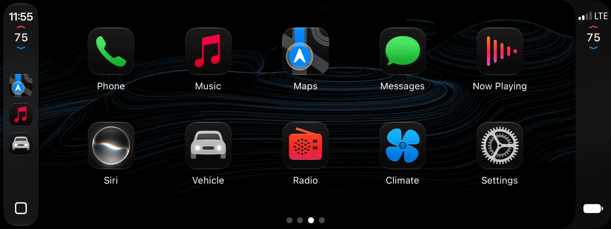

# CarPlay Ultra-Lite

CarPlay Ultra-style features for Hyundai and Kia **Gen5W** head units running **HMG-API**:

- **Climate in CarPlay:**
  - temperatures, fan, A/C, AUTO, SYNC, vents, recirculation, seat heat, and front and rear defrost
  - a climate panel for each seat; the passenger's power button turns off just the passenger side
- **The CarPlay Ultra theme:** wallpapers and colours you pick in CarPlay **Settings > Themes**.

**Status:** tested on a **Hyundai Ioniq 6 (US, firmware 260507)**. The Kia EV6 and Hyundai Ioniq 5 should work too; run the compatibility check first. This is an unofficial mod and you use it at your own risk.

## Download

Get **carplay-ultra-lite-bundle-1.0.0.zip** from the [latest release](../../releases/latest) and unzip it; the USB folders the steps below mention are inside. To run only the compatibility check first, get **carplay-ultra-lite-check-1.0.0-usb.zip** and copy its `HMGAPI` folder to the top of a USB stick.

## What you need

- **HMG-API** 1.0.0 or later, working on your car with your car's hook map.
- **Wireless CarPlay:**
  - Ioniq 6: use the wireless CarPlay/Android Auto fix included here (`usb-2-install-ioniq6-with-wireless-fix`).
  - EV6 and Ioniq 5: use HMG-API's official wireless-carplay-aa.
- **An iPhone** on iOS 26 or later (tested on iOS 27.0).
- **A USB stick.**

## Step 1: compatibility check

1. Copy everything inside `usb-1-check` to the top of the USB stick.
2. Plug the stick into the car. In the **HMG-API app**, open **Updates** and install **CarPlay Ultra-Lite compatibility check**. Confirm the author key `4bec7579-…`, then apply, and restart if it asks.
3. About a minute after the screen is up, the report appears on the stick in **`CarPlayUltraLite-Check`**. Open `cp-climate-check.md` on a computer: the table at the top says **YES** or **NO** for each feature.
4. Remove the check in the HMG-API app. It only reads and changes nothing.

If anything says **NO**, don't install. Open an issue with `cp-climate-check.md` and `cp-climate-check.json` attached, or give both to your own Claude together with the `source` folder.

## Step 2: install

1. If the check says an E-GMP CarPlay EV Routing mod on your car is **signed by another author**, remove it in the HMG-API app first. Why: the theme needs the build included here, and the two can't be installed side by side:
   - **HMG-API won't swap them.** Both have the same mod ID, and HMG-API only updates a mod with a package from the same author.
   - **A new name wouldn't help.** Both builds change the same parts of the car's CarPlay connection, so running both could break wireless CarPlay.
   - **You lose nothing.** The build included here does everything the original does, and adds the theme.
2. Copy everything inside **`usb-2-install-ioniq6-with-wireless-fix`** (Ioniq 6: it also brings the wireless CarPlay/Android Auto fix the Ioniq 6 needs) or **`usb-2-install-ev6-ioniq5`** (EV6 and Ioniq 5, which already have wireless CarPlay from HMG-API) to the top of the stick.
3. In the HMG-API app, open **Updates** and install every package:
   - Order: wireless-carplay-aa first (Ioniq 6 only), then E-GMP CarPlay EV Routing (it tells the iPhone which theme to load), then CarPlay Ultra-Lite.
   - Confirm the author key `4bec7579-…`.
   - On an EV6 or Ioniq 5, choose **Install anyway**.
4. Apply the changes and restart the head unit.

## Step 3: pair the iPhone again (once)

1. On the iPhone, go to **Settings > General > CarPlay**, tap your car, then **Forget This Car**, and connect again. Keep the iPhone online the first time: it downloads the theme.
2. On the car, open CarPlay **Settings > Themes** and pick a style and wallpaper.

## Settings (HMG-API app)

| Mod | Setting | Default | Notes |
|---|---|---|---|
| CarPlay Ultra-Lite | CarPlay Ultra | on | Off: climate only, with the classic CarPlay look. Also turn EV Routing's CarPlay theme off. |
| CarPlay Ultra-Lite | Rear window defrost | on | Works in READY only. |
| E-GMP CarPlay EV Routing | CarPlay theme | on | Needs CarPlay Ultra on. |

Restart the head unit after changing a setting. After a theme change, also forget and pair the iPhone again.

## Good to know

- **Power buttons:** the driver's turns the climate off; the passenger's turns off only the passenger side.
- **Buttons on both sides:** A/C, recirculation and the defrost buttons show on both seats' panels. That's how CarPlay lays them out.
- **Home button:** the Hyundai/Kia home button is hidden while the theme is on.
- **USB cable:** plugging a cable into the car's USB port can drop CarPlay for a few seconds; it reconnects by itself.

## Troubleshooting

- **CarPlay stays black:** turn off EV Routing's **CarPlay theme** and restart.
- **The head unit keeps restarting:** HMG-API turns mod hooks off by itself after 3 quick restarts, and CarPlay Ultra-Lite turns itself off after two crashes within 10 minutes. Then disable CarPlay Ultra-Lite in the HMG-API app.
- **Reporting a problem:** attach the check report. Never post iPhone logs publicly: they contain your car's Wi-Fi password.

## Credits and licence

- The climate and vehicle protocol is based on [LIVI](https://github.com/f-io/LIVI) by Lasse Heitgres (GPL-3.0).
- Wireless CarPlay and Android Auto come from [HMG-API](https://github.com/VysseCodes/HMG-API) (AGPL-3.0).
- The theme is switched on through a modified build of the E-GMP CarPlay EV Routing mod (GPL-3.0), which is not part of this project.
- CarPlay Ultra-Lite is GPL-3.0-or-later. Its source code, and the source of the other two mods, is in the bundle's `source/` folder.

Not affiliated with Apple, Hyundai, Kia or Aston Martin. CarPlay is a trademark of Apple Inc.
